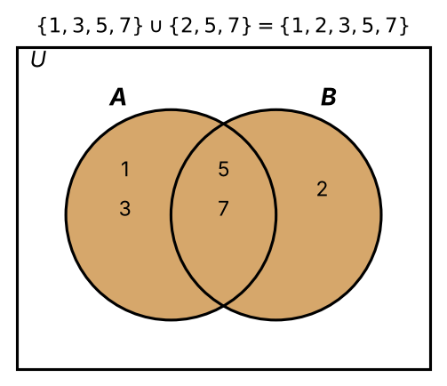
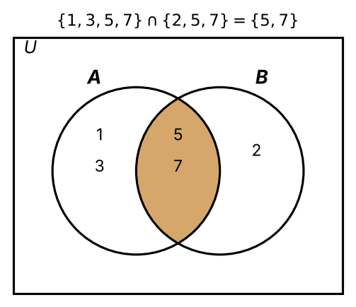
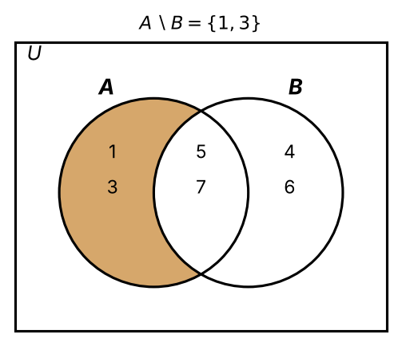
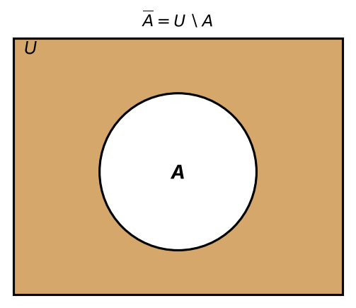
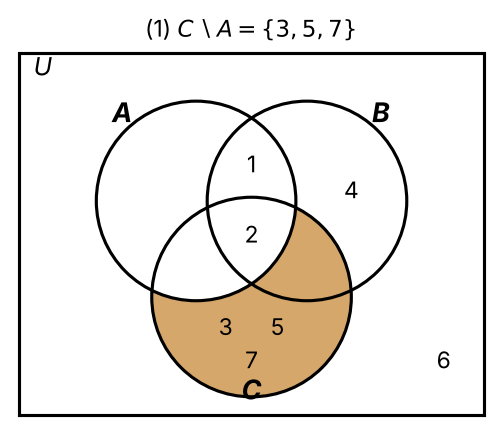
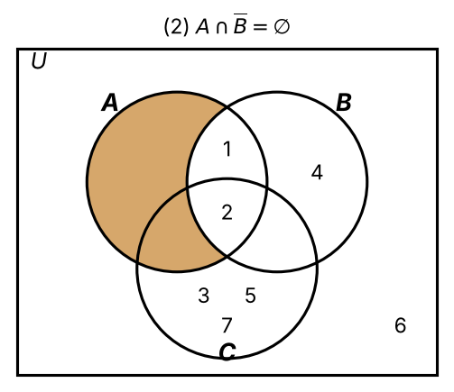
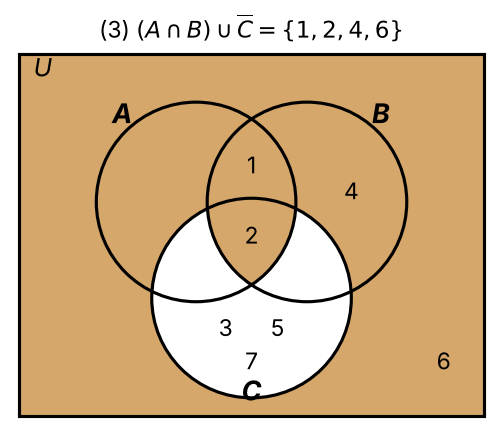
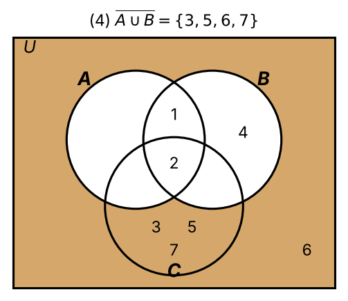
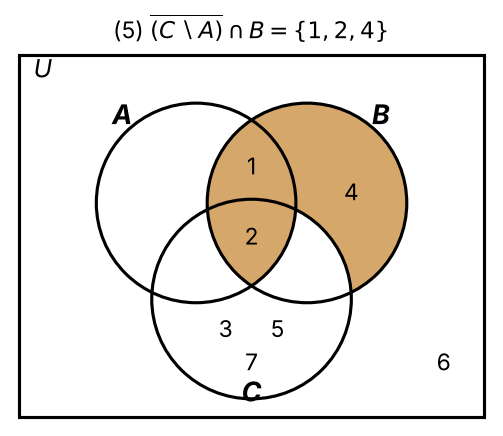

:PROPERTIES:
:ID:       24bd9fa0-ec74-4022-a680-d59e88125c5a
:END:
#+title: Set Operations

* Set Operations

Operations for *combining*, *comparing* and *manipulating* sets:
- *Union*
- *Intersection*
- *Difference*
- *Complement*

\(:=\) means "equal by definition".

** Union (Def 7.5)

\[ A \cup B := \{ x \mid x \in A \text{ or } x \in B \} \]
- *Inclusive "or"*: \(x\) may be in *both* \(A\) and \(B\).

*** Example:
- \(\{1,3,5,7\} \cup \{2,5,7\} = \{1,2,3,5,7\}\)

#+ATTR_ORG: :width 500

** Intersection (Def 7.6)

\[ A \cap B := \{ x \mid x \in A \text{ and } x \in B \} \]

*** Example:
- \(\{1,3,5,7\} \cap \{2,5,7\} = \{5,7\}\)

#+ATTR_ORG: :width 500

** Difference (Def 7.7)

\[ A \setminus B := \{ x \mid x \in A \text{ and } x \notin B \} \]

*** Example:

  \(A = \{1,3,5,7\}\), \(B = \{4,5,6,7\}\) \(\Rightarrow\) \(A \setminus B = \{1,3\}\).

#+attr_org: :width 400

** Complement (Def 7.8)

All sets under consideration are *subsets* of a /universal set/ \(U\).
\[ \overline{A} := U \setminus A = \{ x \in U \mid x \notin A \} \]

*** Example:

- Everything (in \(U\)) that is *not* in \(A\).
- Depends on the choice of \(U\).

#+attr_org: :width 400

** Link to logic

| Set operation               | Logical connective    | Reading |
|-----------------------------+-----------------------+---------|
| Union \(\cup\)              | Disjunction \(\lor\)  | or      |
| Intersection \(\cap\)       | Conjunction \(\land\) | and     |
| Complement \(\overline{A}\) | Negation \(\neg\)     | not     |

** Worked example

\(U = \{1,\dots,7\}\)

\(A = \{1,2\}\)

\(B = \{1,2,4\}\)

\(C = \{2,3,5,7\}\)

1. \(C \setminus A = \{3,5,7\}\)

   #+attr_org: :width 400
   

2. \(\overline{B} = \{3,5,6,7\}\), so \(A \cap \overline{B} = \varnothing\)

   #+attr_org: :width 400
   

3. \(A \cap B = \{1,2\}\), \(\overline{C} = \{1,4,6\}\), so \((A \cap B) \cup \overline{C} = \{1,2,4,6\}\)

   #+attr_org: :width 400
   

4. \(A \cup B = \{1,2,4\}\), so \(\overline{A \cup B} = \{3,5,6,7\}\)

   #+attr_org: :width 400
   

5. \(\overline{C \setminus A} = \{1,2,4,6\}\), so \(\overline{(C \setminus A)} \cap B = \{1,2,4\}\)

   #+attr_org: :width 400
   

Tip: compute *inner* expressions first, then complement relative to \(U\).
