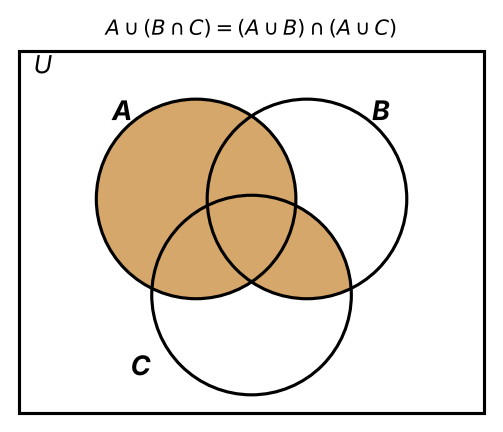
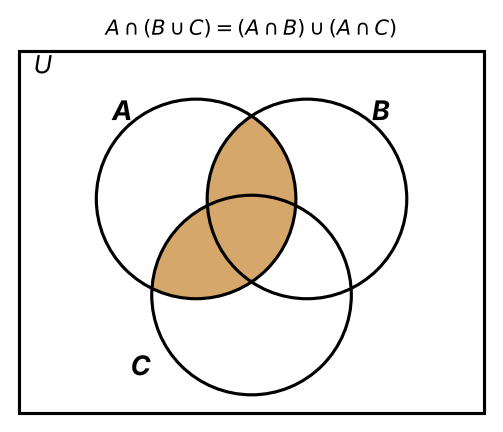
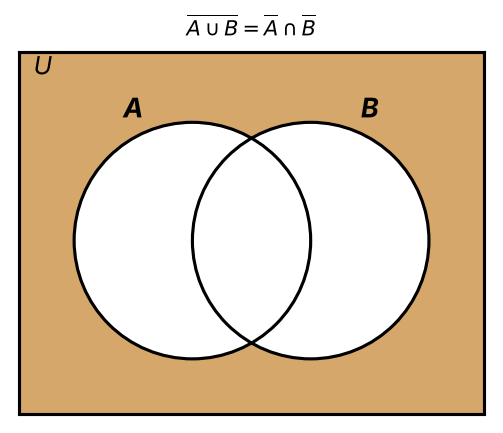
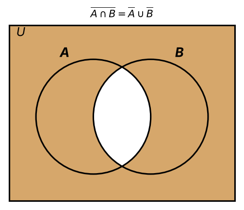

:PROPERTIES:
:ID:       a3417cbc-8a82-4b81-bb2b-e38e85792e24
:END:
#+title: Set Operation Laws

* Set Operation Laws

Rules for spotting when two sets are *equal* without checking every element.

** Associativity

\[ A \cup (B \cup C) = (A \cup B) \cup C \]
\[ A \cap (B \cap C) = (A \cap B) \cap C \]
- *Grouping* doesn't matter, so brackets can be dropped: \(A \cup B \cup C\).

** Commutativity

\[ A \cup B = B \cup A \]
\[ A \cap B = B \cap A \]
- *Order* doesn't matter.

** Distributive Rules

*** (I) \(\cup\) over \(\cap\)

\[ A \cup (B \cap C) = (A \cup B) \cap (A \cup C) \]

#+attr_org: :width 400

*** (II) \(\cap\) over \(\cup\)

\[ A \cap (B \cup C) = (A \cap B) \cup (A \cap C) \]

#+attr_org: :width 400

- Like \(a(b + c) = ab + ac\), but it works *both ways* for sets.

** De Morgan's Rules

*** (I)

\[ \overline{A \cup B} = \overline{A} \cap \overline{B} \]

#+attr_org: :width 400

*** (II)

\[ \overline{A \cap B} = \overline{A} \cup \overline{B} \]

#+attr_org: :width 400

- Complement the parts and *flip* the operation (\(\cup \leftrightarrow \cap\)).

** Empty set

\[ A \cup \varnothing = A \qquad A \cap \varnothing = \varnothing \]
- \(\varnothing\) is the *identity* for \(\cup\) and *absorbs* under \(\cap\).

** Link to logic

Each law mirrors a propositional equivalence, with \(\cup \to \lor\), \(\cap \to \land\) and complement \(\to \neg\):

| Set law                                                  | Logic equivalent                                           |
|----------------------------------------------------------+------------------------------------------------------------|
| \(A \cup B = B \cup A\)                                  | \(p \lor q \equiv q \lor p\)                               |
| \(A \cap (B \cup C) = (A \cap B) \cup (A \cap C)\)       | \(p \land (q \lor r) \equiv (p \land q) \lor (p \land r)\) |
| \(\overline{A \cup B} = \overline{A} \cap \overline{B}\) | \(\neg(p \lor q) \equiv \neg p \land \neg q\)              |
| \(\overline{A \cap B} = \overline{A} \cup \overline{B}\) | \(\neg(p \land q) \equiv \neg p \lor \neg q\)              |
