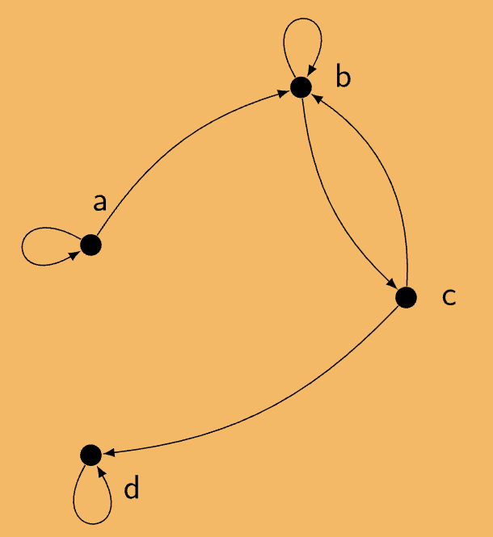

:PROPERTIES:
:ID:       68b07956-a249-4854-acb5-b401cf07ba4f
:END:
#+title: Directed Graphs (Digraphs)

* Directed Graphs (Digraphs)

** Overview
A *directed graph* (digraph) visualises a *relation* as a network of *vertices ("blobs")* and *arrows*.

** Construction

Let \(S\) be a (small) *finite* set and \(R\) a relation on \(S\).

- Draw one vertex for each element of \(S\).
- Draw an arrow from \(x\) to \(y\) iff \((x,y) \in R\).
- A pair \((x,x) \in R\) gives a *loop* at \(x\).

** Example

\(S = \{a,b,c,d\}\),
\[ R = \{(a,a),(a,b),(b,b),(b,c),(c,b),(c,d),(d,d)\} \]

#+ATTR_ORG: :width 500

Reading the graph:
- Loops at \(a\), \(b\), \(d\) — from \((a,a),(b,b),(d,d)\). No loop at \(c\).
- \(a \to b\)
- \(b \to c\) and \(c \to b\) — a two-way pair.
- \(c \to d\)
