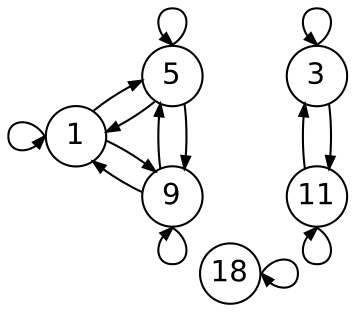
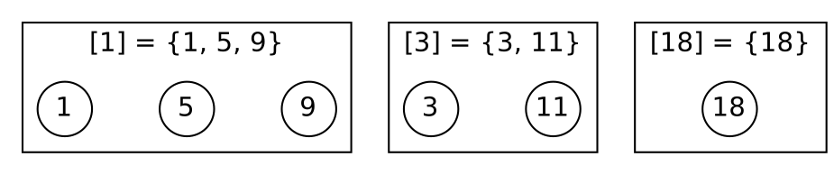

:PROPERTIES:
:ID:       c6025cb2-8fde-4e0f-94de-02a2b04b04e1
:END:
#+title: Equivalence Relations

* Equivalence Relations

** Idea

An *equivalence relation* behaves like /equality/ $=$: it treats elements as "the same" when they share some property,
even if they are not strictly equal.

In doing so it groups elements that "look alike" into *equivalence classes*.

** Definition 7.10

A relation $R$ on a set $A$ that is

- *reflexive*: $(a,a) \in R$ for all $a \in A$
- *symmetric*: $(a,b) \in R \Rightarrow (b,a) \in R$
- *transitive*: $(a,b) \in R \land (b,c) \in R \Rightarrow (a,c) \in R$

is called an *Equivalence Relation*.

** Example: $4 \mid a - b$

Let $A = \{1, 3, 5, 9, 11, 18\}$ and
\[ R = \{(a,b) \in A \times A : 4 \mid a - b\} \]

- Reflexive :: $a - a = 0$, and $4 \mid 0$.
  - So every $(a,a) \in R$.
- Symmetric :: if $4 \mid a - b$ then $4 \mid -(a-b) = b - a$.
  - So $(a,b) \in R \Rightarrow (b,a) \in R$.
- Transitive :: if $4 \mid a - b$ and $4 \mid b - c$ then $4 \mid (a-b)+(b-c) = a - c$.
  - So $(a,b),(b,c) \in R \Rightarrow (a,c) \in R$.

*** Directed graph of $R$

#+ATTR_ORG: :width 700

*** Visualizing Equivalence

Reading the properties off the graph:
- *Reflexive*: every vertex has a *loop*.
- *Symmetric*: every arrow $a \to b$ has a *matching* arrow $b \to a$.
- *Transitive*: whenever there is a path $a \to b \to c$ there is a direct arrow $a \to c$.
  - Each connected piece is /complete/: every *vertex* points to every other *vertex* in the same piece.

*** Equivalence classes

The graph splits into disconnected pieces, and each piece is an equivalence class:

| Class $[a]$ (named by representative $a$) | Members       | $a \bmod 4$ |
|-------------------------------------------+---------------+-------------|
| $[1]$                                     | $\{1, 5, 9\}$ |           1 |
| $[3]$                                     | $\{3, 11\}$   |           3 |
| $[18]$                                    | $\{18\}$      |           2 |

#+ATTR_ORG: :width 700

The classes are *non-empty*, *pairwise disjoint*, and their *union* is $A$, so they form a *partition* of $A$.

*** Representatives

\[ [a] = \{x \in A : (a, x) \in R\} \]

Any member of a class can be used to name it.
- Called the *representative*.

Picking the smallest is only a convention:

- $[1] = [5] = [9] = \{1, 5, 9\}$
- $[3] = [11] = \{3, 11\}$

In general, $[a] = [b] \iff (a, b) \in R$.
