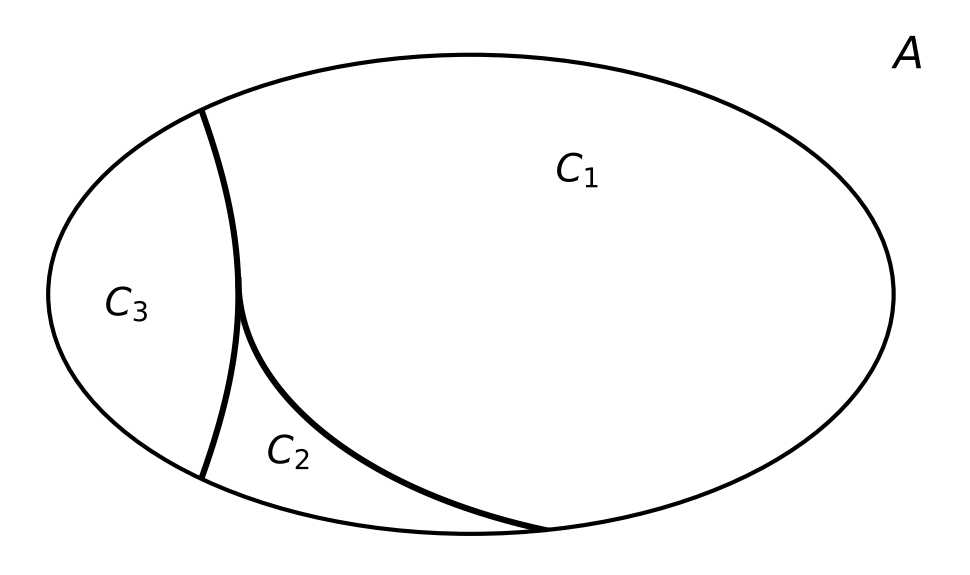

:PROPERTIES:
:ID:       66edb0e4-b567-4910-836a-fbcdf78c6318
:END:
#+title: Equivalence Classes

* Equivalence Classes

** Prerequisite

\(R\) must be an *equivalence relation* on \(A\): reflexive, symmetric and transitive.

** Definition

Given \(A\) with an equivalence relation \(R\), the elements of \(A\) split into
*disjoint* groups (subsets of \(A\)) such that:
- within a group, every element is related to every other element, AND
- no two elements from different groups are related.

These groups are the *equivalence classes* of \(R\). The class of \(a\):
\[ [a]_R = \{\, x \in A \mid aRx \,\} \]

Together the classes form a *partition* of \(A\):
- \(A = C_1 \cup C_2 \cup \dots \cup C_n\) (every element is in some class)
- \(C_i \cap C_j = \varnothing\) for \(i \neq j\) (no two classes share an element)

** Procedure: finding the classes

1. Pick any element \(a \in A\) not yet in a class.
2. Collect everything \(a\) is related to → that set is \([a]_R\).
3. Repeat with an element not in any class found so far.
4. Stop when every element is placed. A leftover element related only to itself is a class of its own.

** Example

\(A = \{1, 3, 5, 9, 11, 18\}\) with \(R\) from the previous page.

| Start  | Related to  | Class                 |
|--------+-------------+-----------------------|
| \(1\)  | \(5, 9\)    | \(C_1 = \{1, 5, 9\}\) |
| \(3\)  | \(11\)      | \(C_2 = \{3, 11\}\)   |
| \(18\) | only itself | \(C_3 = \{18\}\)      |

Check:
- *Union*: every element is in some class:
  \(A = C_1 \cup C_2 \cup C_3\) ✓
- *Pairwise intersections* (\(\cap\) = elements in common): no element is in two classes:
  - \(C_1 \cap C_2 = \{1,5,9\} \cap \{3,11\} = \varnothing\)
  - \(C_1 \cap C_3 = \{1,5,9\} \cap \{18\} = \varnothing\)
  - \(C_2 \cap C_3 = \{3,11\} \cap \{18\} = \varnothing\) ✓
- Together: each element of \(A\) is in *exactly one* class, so \(\{C_1, C_2, C_3\}\) is a partition of \(A\).

** Graphical view

The equivalence classes are exactly the *connected components* of the
graphical representation of \(R\) (here: three components).

Schematic of \(A\) partitioned into its equivalence classes:

#+caption: Set \(A\) partitioned into equivalence classes \(C_1, C_2, C_3\)
#+ATTR_ORG: :width 500

