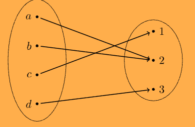

:PROPERTIES:
:ID:       b14f2f86-0696-45cc-80a0-481aa3e536d9
:END:
#+title: Surjectivity

* Surjectivity

See also: [[id:1f2c4027-5f19-4524-bb87-8e4e2fdf5b8d][Image and Preimage]].

** Definition

*Definition 8.2.* A function $f : A \to B$ is *surjective* (onto) if its *range* is equal to its *codomain*:

\[ \operatorname{ran}(f) = B \]

Equivalently, /every/ element of the *codomain* is the image of /at least one/ element of the *domain*:

\[ \forall b \in B \;\, \exists a \in A \;\, f(a) = b \]

** Diagram

A surjective function $f : \{a, b, c, d\} \to \{1, 2, 3\}$.

/Every/ element of the *codomain* is hit, so the *range* equals the *codomain*.

#+attr_latex: :width 0.5\textwidth
#+ATTR_ORG: :width 500

| $x$    | $a$ | $b$ | $c$ | $d$ |
|--------+-----+-----+-----+-----|
| $f(x)$ |   2 |   2 |   1 |   3 |

- $2$ has two preimages ($a$ and $b$), so *surjective* functions don't have to be *injective*.
- Removing $d$ would leave $3$ unhit, and $f$ would no longer be *surjective*.

** Making a function surjective by restricting the codomain

Any function becomes *surjective* if its *codomain* is replaced by its *range*.

*Example.* $f : \mathbb{R} \to \mathbb{R}$, $f(x) = x^2$ is /not/ surjective, because e.g. $-1$ has no preimage.

If we redefine

\[ f : \mathbb{R} \to \mathbb{R}_{\geq 0}, \quad \mathbb{R}_{\geq 0} := \{ x \in \mathbb{R} \mid x \geq 0 \} \]

then $f$ is *surjective*, since /every/ $y \geq 0$ has the preimage $\sqrt{y}$.

** Proving surjectivity

1. Take an arbitrary $b \in B$.
2. Construct an $a \in A$ (usually by solving $f(a) = b$ for $a$).
3. Check that $a \in A$ and $f(a) = b$.

To /disprove/ it, find a single $b \in B$ with no preimage.

** Notes
- For finite sets, a *surjection* $A \to B$ requires $|A| \geq |B|$.
- *Surjectivity* depends on the stated codomain, not just the formula.
