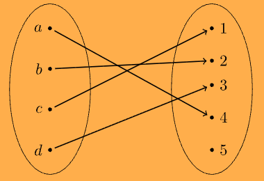

:PROPERTIES:
:ID:       554bede2-5319-4a37-9453-f39259dade77
:END:
#+title: Injectivity

* Injectivity

** Definition

*Definition 8.3.* A function $f : A \to B$ is *injective* (one-to-one) if *no two distinct elements* of the *domain* have the /same/ *image*.

Different inputs *always* give different outputs:

\[ \forall a_1, a_2 \in A \;\, (a_1 \neq a_2 \rightarrow f(a_1) \neq f(a_2)) \]

Equivalently (contrapositive, usually easier to prove):

\[ \forall a_1, a_2 \in A \;\, (f(a_1) = f(a_2) \rightarrow a_1 = a_2) \]

In terms of *preimages*: every $b \in B$ has *at most one* preimage.

** Diagram

An injective function $f : \{a, b, c, d\} \to \{1, 2, 3, 4, 5\}$.

/Different/ *inputs* are mapped to /different/ *outputs*.

#+attr_org: :width 400
#+attr_latex: :width 0.5\textwidth

| $x$    | $a$ | $b$ | $c$ | $d$ |
|--------+-----+-----+-----+-----|
| $f(x)$ |   4 |   2 |   1 |   3 |

- No element of the codomain has more than one arrow coming in, so $f$ is injective.
- $5$ has no preimage, so $f$ is *not* [[id:b14f2f86-0696-45cc-80a0-481aa3e536d9][surjective]].
  - *Injective* functions don't have to be *surjective*.

** Example: Not Injective

$f : \mathbb{R} \to \mathbb{R}$, $f(x) = x^2$ is *not* injective, because *two different inputs* give the *same output*:

\[ f(-2) = (-2)^2 = 4, \quad f(2) = 2^2 = 4 \]

Likewise, the function in [[id:b14f2f86-0696-45cc-80a0-481aa3e536d9][Surjectivity]] is not injective, since $f(a) = f(b) = 2$.

** Making a Function Injective by Restricting the Domain

If we restrict the *domain* to $\mathbb{R}_{\geq 0}$, then $f : \mathbb{R}_{\geq 0} \to \mathbb{R}$, $f(x) = x^2$ is *injective*.

/Proof./ Let $x_1, x_2 \geq 0$ with $x_1^2 = x_2^2$.

Then $x_1 = \sqrt{x_1^2} = \sqrt{x_2^2} = x_2$. $\blacksquare$

Compare: [[id:b14f2f86-0696-45cc-80a0-481aa3e536d9][surjectivity]] is fixed by restricting the *codomain*, while *injectivity* is fixed by restricting the *domain*.

** Proving Injectivity

1. Assume $f(a_1) = f(a_2)$ for arbitrary $a_1, a_2 \in A$.
2. Use algebra to show $a_1 = a_2$.

To /disprove/ it, find one pair $a_1 \neq a_2$ with $f(a_1) = f(a_2)$.

** Injective vs Surjective

| Property     | Each $b \in B$ has ...  | Fix by restricting |
|--------------+-------------------------+--------------------|
| *Injective*  | at most one *preimage*  | *domain*           |
| *Surjective* | at least one *preimage* | *codomain*         |

** Synonyms

- One-to-one
- An injective function is an *injection*

Don't confuse /one-to-one/ (*injective*) with /one-to-one correspondence/, which means *bijective*.

** Notes

- For /finite sets/, an *injection* $A \to B$ requires $|A| \leq |B|$.
