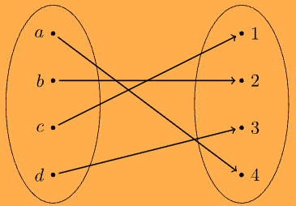

:PROPERTIES:
:ID:       a7a67888-ddc9-4fb8-be8a-a2a1b0b98445
:END:
#+title: Bijectivity

* Bijectivity

** Definition

*Definition 8.4.* A function that is both [[id:554bede2-5319-4a37-9453-f39259dade77][injective]] and [[id:b14f2f86-0696-45cc-80a0-481aa3e536d9][surjective]] is called *bijective*.

A *bijective* function $f : X \to Y$ sets up a *one-to-one correspondence* between the elements of $X$ and $Y$.

In terms of *preimages*: every $y \in Y$ has *exactly one* preimage.

\[ \forall y \in Y \;\, \exists! x \in X \;\, f(x) = y \]

** Diagram

A *bijective* function $f : \{a, b, c, d\} \to \{1, 2, 3, 4\}$.

*Different inputs* are mapped to *different outputs*, and the *range* equals the *codomain*.

#+attr_org: :width 400
#+attr_latex: :width 0.5\textwidth

| $x$    | $a$ | $b$ | $c$ | $d$ |
|--------+-----+-----+-----+-----|
| $f(x)$ |   4 |   2 |   1 |   3 |

- Every element of the *codomain* has *exactly one* arrow coming in.
- *Injective*: no element of the codomain is hit twice.
- *Surjective*: no element of the codomain is missed.

** Example

$f(x) = x^2$ depends on both *domain* and *codomain*:

| Function                                      | Injective | Surjective | Bijective |
|-----------------------------------------------+-----------+------------+-----------|
| $\mathbb{R} \to \mathbb{R}$                   | no        | no         | no        |
| $\mathbb{R} \to \mathbb{R}_{\geq 0}$          | no        | yes        | no        |
| $\mathbb{R}_{\geq 0} \to \mathbb{R}$          | yes       | no         | no        |
| $\mathbb{R}_{\geq 0} \to \mathbb{R}_{\geq 0}$ | yes       | yes        | yes       |

** Proving bijectivity

Prove both parts separately:
1. *Injective:* assume $f(x_1) = f(x_2)$ and show $x_1 = x_2$.
2. *Surjective:* take an arbitrary $y \in Y$ and find $x \in X$ with $f(x) = y$.

** Summary

| Property   | Each element of the codomain has ... |
|------------+--------------------------------------|
| Injective  | at most one preimage                 |
| Surjective | at least one preimage                |
| Bijective  | exactly one preimage                 |

** Synonyms

- One-to-one correspondence
- A bijective function is a *bijection*

** Notes

- For /finite sets/, a *bijection* $X \to Y$ exists iff $|X| = |Y|$.
- *Bijections* are exactly the functions that have an inverse function $f^{-1} : Y \to X$.
