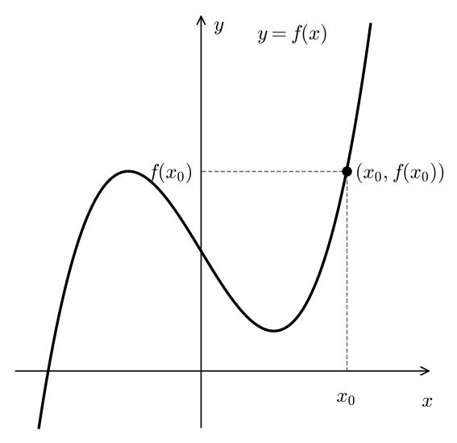
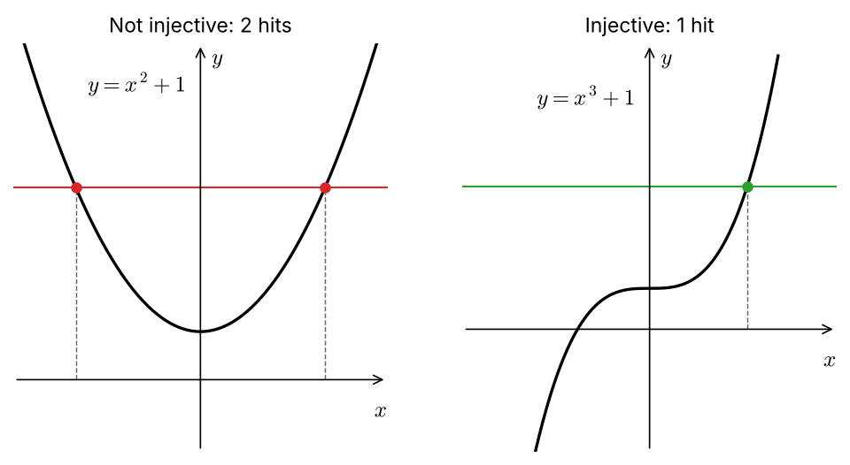

:PROPERTIES:
:ID:       c4cff7de-9e6a-4031-a2de-86a7a6e1a281
:END:
#+title: Graphing a Function

* Graphing a Function

** Definition

The *graph* of a function \(f : X \to Y\) is the set
\[
\operatorname{Graph}(f) = \{(x, f(x)) \mid x \in X\} \subseteq X \times Y.
\]

- It's a set of ordered pairs — one pair per input.
- Since \(f\) is a function, each \(x \in X\) appears as a first coordinate *exactly once*.

** Plotting when \(X, Y \subseteq \mathbb{R}\)

- Draw two perpendicular axes, each a copy of \(\mathbb{R}\): horizontal = \(x\), vertical = \(y\).
- For each \(x_0 \in X\), place a dot at height \(f(x_0)\) directly above \(x_0\), i.e. at the point \((x_0, f(x_0))\).
- The resulting picture is the *plot of the graph of \(f\)*, a.k.a. the *graph of the equation* \(y = f(x)\).

#+caption: The point \((x_0, f(x_0))\) sits at height \(f(x_0)\) directly above \(x_0\).
#+attr_org: :width 400

** Why bother

Graphs let us read off properties of \(f\) visually — e.g. whether \(f\) is one-to-one via the Horizontal Line Test.

** Horizontal Line Test

\(f\) is *one-to-one (injective)* \(\iff\) every horizontal line meets the graph of \(y = f(x)\) *at most once*.

- Why it works: a horizontal line \(y = c\) hits the graph at every \((x, c)\) with \(f(x) = c\). Two hits means \(x_1 \neq x_2\) with \(f(x_1) = f(x_2)\) — exactly a failure of injectivity.
- "At most once", not "exactly once": missing the graph entirely is fine (that's about surjectivity, not injectivity).

*** Examples (\(\mathbb{R} \to \mathbb{R}\))

| Function           | HLT                                                             | Injective? |
|--------------------+-----------------------------------------------------------------+------------|
| \(f(x) = x^2 + 1\) | Line \(y = c\) with \(c > 1\) hits twice (at \(\pm\sqrt{c-1}\)) | No         |
| \(g(x) = x^3 + 1\) | Every horizontal line hits exactly once                         | Yes        |

#+caption: Left: \(y = x^2 + 1\) fails the HLT. Right: \(y = x^3 + 1\) passes.
#+attr_org: :width 650

- Counterexample for \(f\): \(f(-1) = f(1) = 2\).
- For \(g\): \(x_1^3 + 1 = x_2^3 + 1 \Rightarrow x_1^3 = x_2^3 \Rightarrow x_1 = x_2\).

** Caveats

- The HLT is a visual aid, not a proof — a sketch can hide behaviour. Confirm algebraically.
