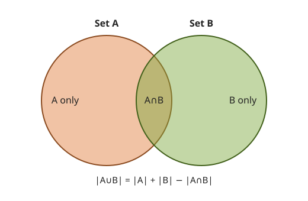
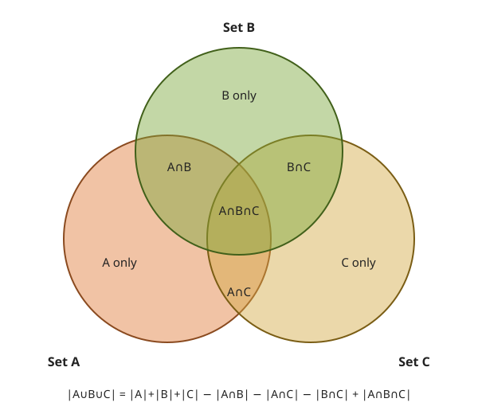
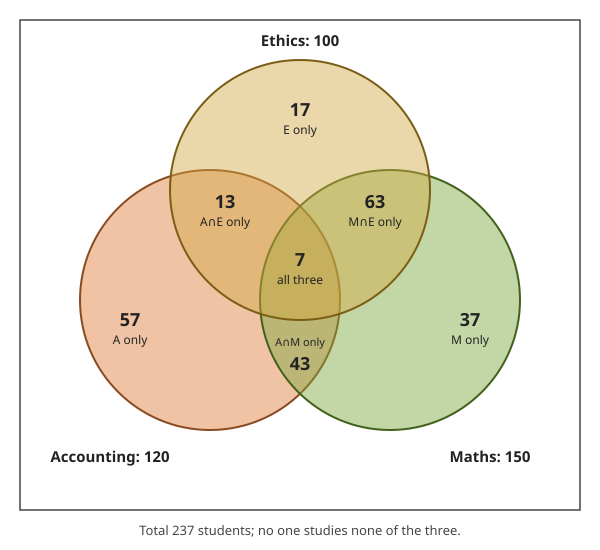

:PROPERTIES:
:ID:       618d8c7e-d946-49bb-8570-7c72f845d425
:END:
#+title: Inclusion-Exclusion Principle

* Inclusion-Exclusion Principle

** Summary

Counting the size of a union of /overlapping/ *finite* sets.

*Add* the sizes of the sets, then *subtract* the /overlaps/ so that elements belonging to more than one set are *not* counted twice.

- For three sets, the triple /overlap/ is added back at the end.

** Notation

- A set is /finite/ if it has *finitely* many elements.
  - Write |A| for the number of elements in A (its /cardinality/).
- An /infinite/ set is one that is not finite.
  - I.e. the set of positive integers is *infinite*.
- Two sets A and B are /disjoint/ if A ∩ B = ∅.
  - Disjoint pieces can be counted /separately/ and their sizes *added*.

** Two sets

If A and B are *finite* sets, then

#+begin_src text
|A ∪ B| = |A| + |B| - |A ∩ B|
#+end_src

The |A ∩ B| term /removes/ the elements that were counted in *both* sets.

#+caption: Two overlapping sets. The lens in the middle is A ∩ B.

** Three sets

The same idea extends to three finite sets A, B, C:

#+begin_src text
|A ∪ B ∪ C| = |A| + |B| + |C| - |A ∩ B| - |A ∩ C| - |B ∩ C| + |A ∩ B ∩ C|
#+end_src

Subtracting the pairwise overlaps removes too much when an element lies in all three sets.

That element was added three times and subtracted three times, so it must be added back once, which is the triple intersection term.

#+caption: Three overlapping sets with every region labelled.

** Method: splitting a set into disjoint pieces

Many problems ask for the size of a set that is only partly described.

- Split it into disjoint pieces, count each, then add.

For example, let X = A ∩ M ∩ Ē (in A and M, not in E) and Y = A ∩ M ∩ E (in all three).

Then X ∩ Y = ∅ and X ∪ Y = A ∩ M, so

#+begin_src text
|A ∩ M| = |X| + |Y|
#+end_src

This is the basic move behind the ~"exactly these sets"~ questions in the examples below.

** Example: Cards

In an ordinary deck, let A be the aces and C the clubs. Then |A| = 4, |C| = 13, and |A ∩ C| = 1 (the ace of clubs). So

#+begin_src text
|A ∪ C| = 4 + 13 - 1 = 16
#+end_src

There are 16 cards that are *aces* or *clubs*.

** Example: Survey

A survey in Scotland finds that 86% of the population have heard of product A, 80% have heard of product B, and 70% have heard of both.

Let N be the *population size*, and let A and B be the sets of people who have heard of /each/ product.

Then
- |A| = 0.86N
- |B| = 0.8N
- |A ∩ B| = 0.7N

So

#+begin_src text
|A ∪ B| = 0.86N + 0.8N - 0.7N = 0.96N
#+end_src

So 96% have heard of /at least/ *one* product, and 4% have heard of *neither*.

Complementing the union gives the answer directly.

#+caption: Survey regions as shares of the population. The outside region is the 4% who have heard of neither product.

** Example: Divisibility (three sets)

How many integers from 1 to 100 are divisible by 2, 3 or 5?

Let U = {1, ..., 100}, and let
- A = {n ∈ U : 2 divides n}, so |A| = 50
- B = {n ∈ U : 3 divides n}, so |B| = 33 (the integer part of 100/3)
- C = {n ∈ U : 5 divides n}, so |C| = 20

A number is divisible by two coprime numbers exactly when it is divisible by their product (equivalently, their least common multiple or "lcm").

So the pairwise overlaps are:
- A ∩ B: divisible by lcm(2, 3) = 6, so |A ∩ B| = 16
- A ∩ C: divisible by lcm(2, 5) = 10, so |A ∩ C| = 10
- B ∩ C: divisible by lcm(3, 5) = 15, so |B ∩ C| = 6

The triple overlap is divisible by 30, so |A ∩ B ∩ C| = 3.

Then

#+begin_src text
|A ∪ B ∪ C| = 50 + 33 + 20 - 16 - 10 - 6 + 3 = 74
#+end_src

So 74 integers are divisible by 2, 3 or 5, and the other 26 are not.

#+caption: Three-set regions for the divisibility example.

** Example: University of Scabia (three sets)

All first-year computer science students at the University of Scabia study at least one of three modules:
- Accounting (A)
- Ethics (E)
- mathematics (M)

There are 237 students.

- 120 study (A)ccounting
- 100 study (E)thics
- 150 study (M)aths

- 50 study (A)ccounting /and/ (M)aths
- 20 study (A)ccounting /and/ (E)thics
- and 70 study (M)aths /and/ (E)thics

*** Part 1: Students who study /all/ three

Since everyone is in /at least/ *one* module, |A ∪ E ∪ M| = 237.

The formula gives

#+begin_src text
237 = 120 + 100 + 150 - 50 - 20 - 70 + |A ∩ E ∩ M|
237 = 230 + |A ∩ E ∩ M|
|A ∩ E ∩ M| = 7
#+end_src

So 7 students study *all three* subjects.

*** Part 2: Accounting /and/ Maths, but /not/ Ethics

Let X = A ∩ M ∩ Ē and Y = A ∩ M ∩ E.

These are *disjoint*, and their union is A ∩ M.

Then

#+begin_src text
|A ∩ M| = |X| + |Y|
50 = |X| + 7
|X| = 43
#+end_src

So 43 students study (A)ccounting /and/ (M)aths but /not/ (E)thics.

#+caption: Students in each region of the Scabia problem. The seven regions sum to 237, so no student falls outside the circles.

